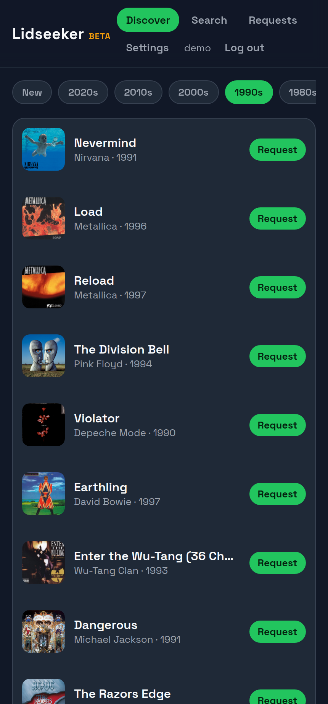
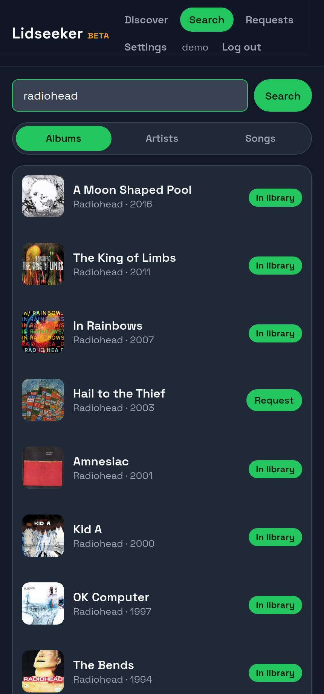
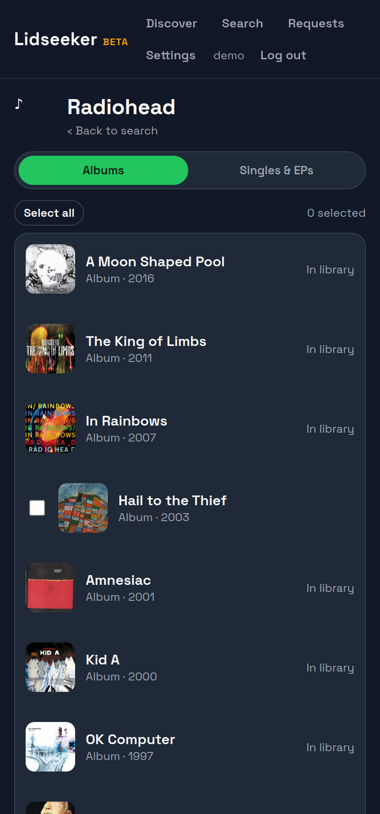
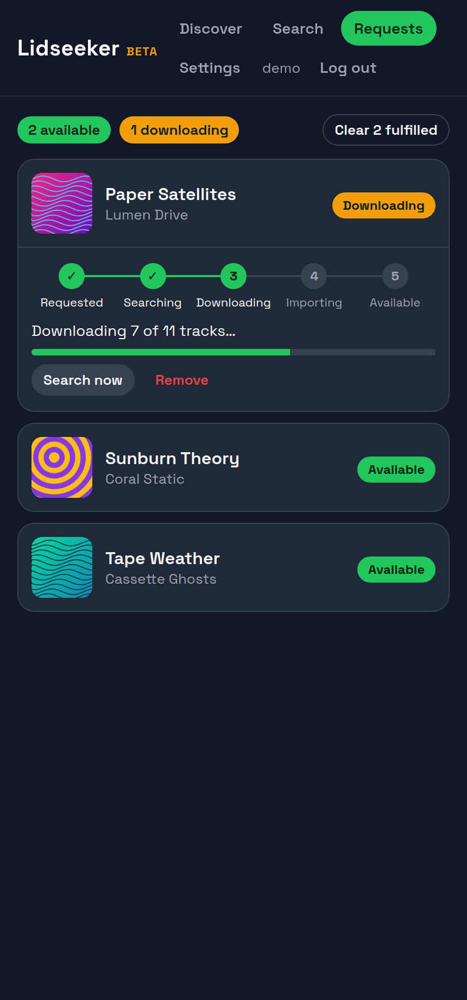
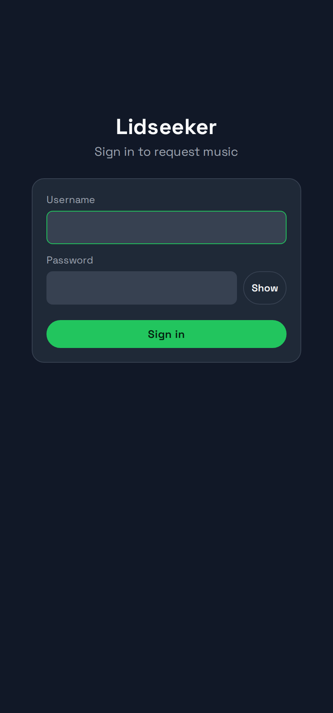
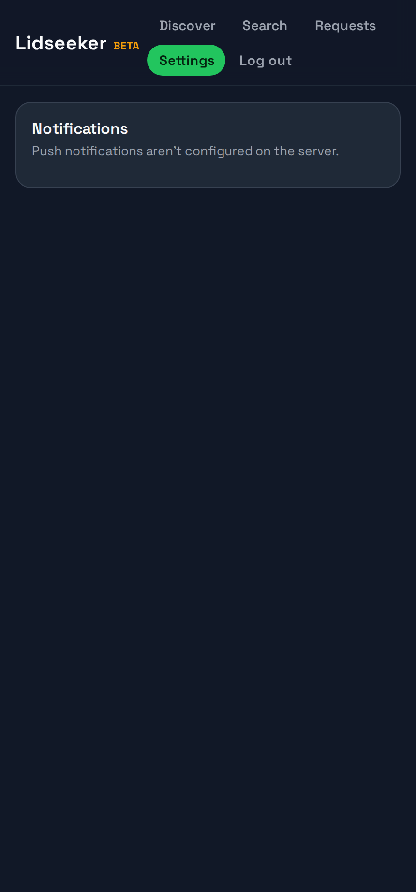

<h1 align="center">Lidseeker</h1>

<p align="center">
  A self-hosted <b>music request &amp; discovery app for <a href="https://lidarr.audio/">Lidarr</a></b> — the "seerr" for music.<br/>
  Browse what's missing from your library, search, tap <b>Request</b>, and watch it go from search → download → import → available, with push notifications when it's ready.
</p>

<p align="center">
  
  <a href="LICENSE"></a>
  <a href="https://github.com/IvoryCobra-VC/lidseeker/actions/workflows/docker-publish.yml"></a>
  <a href="https://github.com/IvoryCobra-VC/lidseeker/pkgs/container/lidseeker"></a>
</p>

---

> [!WARNING]
> **Lidseeker is in beta.** It works and is in daily use, but it's early software — expect rough edges
> and the occasional breaking change. Back up the `/data` volume, and please
> [open an issue](https://github.com/IvoryCobra-VC/lidseeker/issues) for anything you hit. Feedback
> welcome!

Lidseeker has:

- **Backend + Web UI** — a FastAPI service that sits in front of Lidarr **and serves a built-in web app**,
  all in one Docker image. Just open it in a browser. It handles login, search, request orchestration, and
  live status; your Lidarr API key never leaves the server.
- **Android app** *(optional)* — a Kotlin / Jetpack Compose client. The server URL is entered at runtime,
  so one build works against any backend.

```
┌──────────┐
│ Browser  │ ─┐
└──────────┘  │   ┌─────────────┐      ┌────────┐      ┌──────────────────────┐
              ├─► │  Lidseeker  │ ───► │ Lidarr │ ───► │   download client     │
┌──────────┐  │   │   backend   │ HTTP │        │      │ (SABnzbd/qBit/slskd…) │
│ Android  │ ─┘   │  + web UI   │      └────────┘      └──────────────────────┘
└──────────┘      └─────────────┘
```

## Screenshots

<p align="center">
  
  
  
  
</p>
<p align="center"><sub>Discover (browsing the 1990s) · Search · Artist · Requests</sub></p>

<details>
<summary>More screenshots</summary>

<p align="center">
  
  
</p>
</details>

## Quick start

**Prerequisites:** Docker, and a running **Lidarr** instance with an API key and at least one
**download client** configured (any of SABnzbd, qBittorrent, NZBGet, Deluge, Transmission, …).

Create a `docker-compose.yml`:

```yaml
services:
  lidseeker:
    image: ghcr.io/ivorycobra-vc/lidseeker:latest
    container_name: lidseeker
    restart: unless-stopped
    network_mode: host                 # so it can reach Lidarr at localhost:8686
    user: "1000:1000"                  # uid:gid that owns ./lidseeker/data
    environment:
      - TZ=Etc/UTC
      - PORT=5056
      # --- Lidarr ---
      - LIDARR_URL=http://localhost:8686
      - LIDARR_API_KEY=your-lidarr-api-key
      # --- Login (single user) ---
      - APP_USER=admin
      - APP_PASSWORD=change-me                       # plaintext, hashed at startup
      - JWT_SECRET=change-me-to-a-long-random-string # any long random string
    volumes:
      - ./lidseeker/data:/data         # SQLite request store
    healthcheck:
      test: ["CMD", "python", "-c", "import urllib.request; urllib.request.urlopen('http://localhost:5056/api/health')"]
      interval: 1m
      timeout: 5s
      retries: 3
```

Then:

```bash
docker compose up -d
curl localhost:5056/api/health      # {"status":"ok"}
```

Then open **`http://<host>:5056`** in a browser and sign in with your `APP_USER` / `APP_PASSWORD` — the
web UI is built into the backend, nothing else to deploy.

The image is multi-arch (amd64 + arm64), so it runs on x86 servers and ARM boxes (e.g. a Raspberry Pi)
alike.

### Exposing it safely (HTTPS)

Lidseeker speaks plain HTTP and is meant to sit behind a reverse proxy that terminates TLS — don't put
it on the public internet on `:5056` directly. On your LAN, `http://<host>:5056` is fine as-is.

For a public HTTPS URL you have two easy paths:

- **Cloudflare Tunnel / Tailscale** — no ports to open; point the tunnel at `http://<host>:5056`.
- **Bundled Caddy overlay** — automatic Let's Encrypt certificates, one command:

  ```bash
  DOMAIN=lidseeker.example.com \
  docker compose -f docker-compose.yml -f docker-compose.tls.yml up -d
  ```

  (`DOMAIN` must resolve to this host and ports 80 + 443 must be reachable for the ACME challenge.)
  Already run Traefik or nginx? Just proxy it to `http://<host>:5056` instead.
  (`docker-compose.tls.yml` lives in [`backend/`](backend) — clone the repo and run the command from
  there, or copy the file next to your own `docker-compose.yml`.)

**When exposing it, also:**

- Use a strong `APP_PASSWORD`. The login endpoint is rate-limited (failed attempts per IP), and a
  random `JWT_SECRET` is generated + persisted automatically if you don't set one.
- Set `TRUST_PROXY=true` so the rate-limiter sees real client IPs via `X-Forwarded-For`.
- Set `SECURITY_HSTS=true` once you're always on HTTPS.

The backend ships safe response headers (`X-Content-Type-Options`, `X-Frame-Options`, `Referrer-Policy`);
add a Content-Security-Policy at your proxy if you want one. See [`.env.example`](backend/.env.example)
for all hardening settings.

### Optional: Android app

Prefer a native app? **Download the latest `lidseeker-*.apk` from the
[releases page](https://github.com/IvoryCobra-VC/lidseeker/releases)** and sideload it (enable
"install from unknown sources"). A `SHA256` checksum file is published alongside each APK for
verification. On first launch, enter the backend URL and your `APP_USER` / `APP_PASSWORD`.

(You can also build it yourself — see [`android/`](android).)

## Recommended stack

| Component | Role | Required |
|---|---|---|
| [Lidarr](https://lidarr.audio/) | Music library manager + metadata | ✅ |
| A Lidarr **download client** (SABnzbd, qBittorrent, NZBGet, …) | Fetches the music | ✅ |
| [slskd](https://github.com/slskd/slskd) + [Soularr](https://github.com/mrusse/soularr) | Optional Soulseek adapter (live transfer progress + quality toggle) | optional |

## Download backends

Lidseeker works with **any** Lidarr download client out of the box — it reads download progress straight
from Lidarr's own queue ("Lidarr-native" mode). There's also an optional **Soularr + slskd (Soulseek)
adapter** that adds live Soulseek transfer progress and a FLAC/MP3 quality toggle; it auto-enables when an
slskd API key + Soularr config are present. Controls that only apply to that adapter are hidden in the app
when it's off.

| Capability | Lidarr-native | Soularr + slskd |
|---|---|---|
| Request → monitor → import → available | ✅ | ✅ |
| Live download progress | ✅ (Lidarr queue) | ✅ (Soulseek transfers, earlier visibility) |
| Give-up after N searches → "Failed" | ✅ | ✅ |
| FLAC/MP3 quality toggle | — | ✅ |
| "Search now" (per request) | ✅ (Lidarr AlbumSearch) | ✅ (restart Soularr) |
| Push notifications (ntfy) | ✅ | ✅ |

To enable the adapter, set the `SLSKD_*` / `SOULARR_*` vars and layer the overlay (it adds the Soularr
config mount + a locked-down docker-socket proxy — `docker-compose.soularr.yml` also lives in
[`backend/`](backend), so clone the repo for this one too):

```bash
docker compose -f docker-compose.yml -f docker-compose.soularr.yml up -d
```

## Features

**Find music**

- **Discover** — unowned releases from artists already in your library. **New** shows the latest
  releases; the **decade** and **genre** chips browse by popularity, so "1990s" opens with the decade's
  best-known records rather than whatever came out in December 1999. Filters combine, and on the web
  they live in the URL so Back restores your view.
- **Smart search** — artists, albums, and individual songs (MusicBrainz metadata via Lidarr). Search an
  artist's name on the Albums tab and their actual studio albums and EPs come first, ahead of
  bootlegs, tributes and other artists' songs that share the name.
- **Track lists before you request** — expand any album (Discover, Search, artist page) to see its
  songs and running times. Tap an album to jump to its artist's full discography.
- **"In library" badges** — based on real downloaded files, so you don't re-request what you own.
- **Cover art everywhere** — falls back to the Cover Art Archive when Lidarr has no image.

**Request and track**

- **One-tap requests** — Lidseeker adds the artist (unmonitored), monitors just that album, and kicks
  off a search. Pick several albums on an artist page and request them together. Song requests
  confirm that the whole album will be fetched.
- **Live request pipeline** — every request shows a 5-stage tracker (requested → searching →
  downloading → importing → available) with a progress bar, pushed instantly via **Server-Sent Events**.
- **Status at a glance** — the web UI shows a ready / downloading / pending / failed summary; the
  Android app turns those into **filter chips** (All · In progress · Ready · Failed).
- **Per-request "Search Now"**, **bulk-clear fulfilled requests**, and **graceful give-up** — a request
  that finds no source after a few search cycles is marked **Failed** with a one-tap **Retry**.
- **Push notifications** — optional [ntfy](https://ntfy.sh) push the moment an album is available. The
  Android app has a one-tap **Subscribe in ntfy** button (and **Copy topic**).

**Run it**

- **One container** — FastAPI backend + built-in web UI; optional native Android app. Your Lidarr API
  key never leaves the server.
- **Fast** — the Discover catalogue is warmed at startup and refreshed in the background, so it opens
  instantly even with thousands of albums.
- **Multi-user** — admin-managed accounts (Settings → Users). Everyone sees their own requests;
  admins see everyone's, with who asked for what. Anyone can change their own password.

## Configuration

All settings are environment variables on the backend container.

**Required**

| Variable | Description |
|---|---|
| `LIDARR_URL` | Your Lidarr base URL (e.g. `http://localhost:8686`) |
| `LIDARR_API_KEY` | Lidarr API key (Settings → General) |
| `APP_USER` | Username of the **first admin** (seeded on first start; add more users in-app) |
| `APP_PASSWORD` | First admin's password (plaintext; hashed at startup). *Or* set `APP_PASS_HASH` to a pre-computed bcrypt hash |
| `JWT_SECRET` | Any long random string used to sign sessions |

**Common optional**

| Variable | Default | Description |
|---|---|---|
| `PORT` | `5056` | Port the backend listens on |
| `TZ` | `UTC` | Timezone |
| `ROOT_FOLDER_PATH` | `/music` | Lidarr root folder used when adding artists |
| `QUALITY_PROFILE_ID` | `1` | Lidarr quality profile id |
| `METADATA_PROFILE_ID` | `1` | Lidarr metadata profile id |
| `NTFY_URL`, `NTFY_TOPIC` | – | Enable ntfy push notifications |
| `SERVICE_LINKS` | – | `Name\|url` chips shown under a request, comma-separated |
| `TRUST_PROXY` | `false` | Set `true` when behind a reverse proxy so rate-limiting uses `X-Forwarded-For` |

**Soularr + slskd adapter (optional)**

| Variable | Description |
|---|---|
| `SOULARR_ENABLED` | `auto` (on when `SLSKD_API_KEY` + Soularr config present), or `true`/`false` |
| `SLSKD_URL`, `SLSKD_API_KEY` | slskd connection |
| `SOULARR_CONTAINER`, `DOCKER_PROXY_URL` | Soularr container name + the docker-proxy URL (for "search now") |
| `SOULARR_CONFIG_PATH`, `SOULARR_DENYLIST_PATH` | Paths to Soularr's mounted config + denylist |

See [`backend/.env.example`](backend/.env.example) for the full annotated list, and
[`backend/README.md`](backend/README.md) for the API/endpoints reference (the backend also serves
interactive docs at `/docs`).

## Volumes

| Path | Purpose |
|---|---|
| `/data` | SQLite request store (`lidseeker.db`) — persist it to keep request history |

## Building from source

The image is published automatically to GHCR, but you can build it yourself:

```bash
git clone https://github.com/IvoryCobra-VC/lidseeker
cd lidseeker/backend
docker compose -f docker-compose.yml -f docker-compose.build.yml up -d --build
```

The Android app builds with `./gradlew assembleDebug` (Android SDK + JDK 17).

## Changelog

Full history and downloads on the [releases page](https://github.com/IvoryCobra-VC/lidseeker/releases).

### v0.5.0-beta
Found by putting the Android app through a hands-on review on a real phone.
- **Discover decades and genres browse by popularity** — previously a decade chip listed newest-first,
  so "1990s" showed hundreds of 1999 releases before reaching 1998. "New" is unchanged.
- **Discover opens instantly** — the catalogue is warmed at startup and served stale-while-revalidate
  (10 min) instead of a multi-second cold fetch on first open.
- **Much better album search** — searching an artist's name now leads with that artist's albums and
  EPs; the remaining loose matches are ranked (artist match → studio over live/compilation → album
  over single → most-rated).
- **Search "In library" fixed** — it now reflects downloaded files, not merely Lidarr knowing the album.
- **No more "· 1" years** — Lidarr's `0001-01-01` "unknown" date is hidden instead of shown as year 1.
- **Cover Art Archive fallback** for albums without Lidarr artwork.
- **Tap an album to open its artist** (Discover + Search, web and Android); artist pages list albums
  newest first.
- **Android:** Discover albums expand to show their track list; titles wrap to two lines with a
  compact Request button instead of being cut off; the keyboard hides when you search; Requests get
  status filter chips; Settings gets **Subscribe in ntfy** / **Copy topic** buttons.
- API: album results carry a new optional `artistForeignId` field.

### v0.4.1-beta
- **Live download progress no longer hammers slskd** — the transfers list is fetched once and shared
  (5 s cache) across all requests being resolved, instead of once per request row.
- **Backend INFO logs actually emit** — the root logger was left at WARNING, silently dropping
  operational logs (search give-up counter, slskd cleanup); httpx per-request noise is filtered out.

### v0.4.0-beta
- **Real-time updates** — request status changes now pushed instantly via Server-Sent Events; no more
  waiting for the next poll cycle to see a download complete.
- **Request stats bar** — available / downloading / pending / failed counts shown at a glance in both
  the web UI and Android app.
- **Per-request Search Now** — trigger a search for a single specific album rather than everything pending
  at once.
- **Clear fulfilled requests** — bulk-remove all "available" requests in one tap.
- **Password change** — any user can change their own password from Settings (web + Android).
- **Track request confirmation** — requesting a song now shows a dialog explaining the full album will be
  downloaded.
- **"In library" badges** — search results and Discover highlight albums already in your library.
- **Discover filter state in URL** — genre/decade filters survive navigation (browser back button restores
  the same filtered view).
- **APK SHA256 checksums** — each release now ships a `.sha256` file for APK verification.
- **Bug fix:** `TRUST_PROXY=true` now correctly reaches the login rate-limiter (previously the
  `X-Forwarded-For` header was ignored, so all logins appeared to come from the proxy IP).

### v0.3.0-beta
- **Multi-user accounts** (admin-managed) — add users in Settings → Users; requests are attributed
  per person; non-admins see only their own, admins see all. `APP_USER`/`APP_PASSWORD` now seed the
  first admin (existing single-user installs upgrade seamlessly). Web UI only this round; the Android
  app still works against any account (in-app user management is a follow-up).

### v0.2.0-beta
- **Built-in web UI** (React/Vite) served by the backend at `/` — full parity with the app (Discover,
  Search, artist detail, request pipeline with retry/remove, Settings). No extra container.

### v0.1.1-beta
- Backend image now published at `ghcr.io/ivorycobra-vc/lidseeker` (updated registry namespace).
- `MUSICBRAINZ_CONTACT` now defaults to the project repo (correct MusicBrainz User-Agent out of the box).
- README/docs polish.

### v0.1.0-beta
- First public beta.
- Search & request (artists / albums / songs), live 5-stage request pipeline, give-up → **Failed** with retry.
- Discover unowned releases by genre/decade; optional ntfy push notifications.
- Works with any Lidarr download client; optional Soularr + slskd (Soulseek) adapter.
- Prebuilt multi-arch (amd64 + arm64) Docker image + sideloadable Android APK.

## License

[MIT](LICENSE). Lidseeker is an independent project. It integrates with Lidarr, and optionally with
Soularr and slskd, **only over their HTTP APIs** (and, for the optional Soularr adapter, by reading/writing
Soularr's own config files) — it contains no code from those projects, which are separately licensed.
